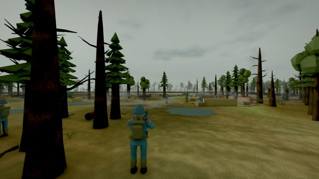

# Sector Control

A single-player First World War shooter that runs in the browser. You fight alongside and against bots for control of flags across trench lines, a shelled forest and a destructible village, in first or third person.



**[Play it in your browser](https://codymorterud.com/sector-control/)** — no sign-in. Use a desktop browser with a keyboard and mouse, and click **Begin operation** to start. Phones and tablets without a mouse see a short notice instead, with a link to share to a computer and a **Try anyway** option; add `?desktop` to the URL to skip it. Passing builds and rendered checks on `main` publish automatically through GitHub Actions.

## Features

- **Large bot battles.** Up to 50 soldiers a side, with riflemen, machine gunners, smoke-screened assaults, suppression, cover-seeking and imperfect aim.
- **Squad AI.** Bots fight in squads of four or five under a team commander that spreads them across the flags. Squads share sightings, move in bounds while half of them cover, man windows on every floor, stack at doors, throw grenades into rooms and leave failing floors. They hear sprinting and reloading, target whoever threatens them most and route round places where teammates died. Choose Recruit, Regular or Veteran in the briefing.
- **Capture the flag.** Trench front, Night raid, Verdun sector and Spring Offensive can also be played as capture the flag: choose it in the briefing or add `?mode=ctf`. Each side keeps three flags at pickup points spread along its own line, so no one spot can be camped; raid any of the enemy's, carry it back across no-man's land to your single drop point and score. Carriers walk and fight with the pistol but can still mantle; a flag falls where its carrier dies, and first to five captures wins. Bot squads raid, escort, intercept carriers and return dropped flags.
- **Nine maps.** Trench front, Night raid, Verdun sector, Spring Offensive, Village front, Lighthouse point, indoor Fort Vaux, the Zeppelin above the clouds, and a guided training camp.
- **Per-map light and atmosphere.** Each map has its own sun, generated sky, fog and color grade, from Trench front's gray dawn to Village front's late afternoon. On Trench front a low sun burns through a heavy cloud deck; mist lies across no-man's land and pools in the trenches, brazier smoke drifts from the shelter bays, fresh craters smoulder, and you hear wind keening in the wire, a machine gun far up the line and crows. On Verdun a lower overcast sun lays long soft shadows through the woods, mist drifts between the trunks across the whole field and pools in the trenches, and the same battlefield sounds carry over the trees. Rooms darken away from their windows. Graphics quality is Auto, Low, Medium or High in the briefing; Auto picks from real frame times.
- **Lived-in trenches.** On Trench front, sandbags line the parados, British stretches mix timber, corrugated iron and sandbag revetments while German ones use timber and wicker, and dugout entrances glow with lanterns. Painted boards name each trench and point to its flag; crates, rifle racks, stretchers, braziers, periscopes, field telephone cable and standing water fill the lines. All of it stays off the firing steps and adds no cover. Verdun's narrower trenches get the same treatment, with French stretches revetted mostly in woven hurdles and boards naming trenches after the sector's places, such as TR. DE FLEURY and DOUAUMONTGRABEN.
- **Wired no-man's land.** On Trench front, each side has a barbed-wire belt in front of its parapet, with gaps at its flags and the center. Your own side knows the lanes through its wire; the enemy's slows you to a walk and rattles as you push through. Shells and grenades cut it. The old craters hold standing water, and the debris of earlier fighting lies between the lines. The ground there is churned to bare, wet earth; grass, winter-dead and straw-colored, survives only behind the lines. Verdun's front lines are wired too, with gaps wherever a sap, route or exit leaves them; water stands in its shell scars, and the open ground and trench floors are churned to mud while leaf litter survives under the trees.
- **A wired battlefield edge.** On Trench front and Verdun sector, a belt of barbed wire marks the edge of the sector and slows you to a walk. Stay beyond it for five seconds and the guns walk a salvo onto you. On Trench front the trenches run on past the wire behind sandbag blocks, and the front continues to the horizon: parapets and wire, broken woods, a shelled village and château, observation balloons, smoke columns, and distant shellfire and flares. On Verdun the woods carry on past the wire and out over hill country, with a ruined village behind the French line and a fort on the ridge behind the German one.
- **Gas shells.** Wherever artillery is offered, press **F** on the tactical map to switch the fire mission to gas shells. Instead of a high-explosive barrage, four gas shells whistle in three seconds later and burst into a low yellow-green cloud that spreads to about 18 m and lingers 25 seconds, drifting slowly along the front. It burns anyone unmasked, your own side included, and uses the same artillery cooldown. The 1917 maps fire mustard gas; Verdun, set in June 1916, fires phosgene in a paler cloud. Press **M** to pull on your gas mask (a second, both hands): masked, gas burns only 1.5 HP a second, you see through two round eyepieces that mist as you breathe, and you cannot aim down sights, so you fire from the hip. Bots mask up, walk out of clouds and fire gas at tight knots of enemies.
- **Destructible battlefields.** Grenades and artillery crater the ground, breach trench banks, fell trees and knock holes in walls, floors and roofs. Buildings collapse when they lose enough support, and bots reroute around the damage.
- **Furnished village interiors.** Limewashed walls, shutters, lanterns, signs, finished ceilings, exposed joists and distinct rooms give the manor, school, inn, farmhouse and workshops their own character. Dining chairs and tableware add domestic detail. Damage reveals brick and splintered timber; collapsed houses leave irregular low rubble.
- **Village outdoor spaces.** Cobbled courts, gravel workyards, vegetable gardens and an orchard connect the houses. Low destructible furniture, barrel clusters, carts and supply positions break up the approaches while roads and doorways stay open.
- **Coastal headland.** Layered sea cliffs, foreshore rocks, short coastal grass, rippled water and destructible garden furniture surround Lighthouse Point’s three flags.
- **Limited reinforcements at the end.** In the final two minutes, or once either side reaches 240 points, each side's respawns come from a pool of one per soldier. When it runs dry the fallen stay down, and a side with nobody left standing loses on the spot. The HUD shows both pools under the score and warns when yours runs low; once you are out you watch your teammates fight on.
- **Three roles.** Rifleman, Marksman and Support, each with a faction-specific primary and a pistol, plus grenades, smoke, bayonets, callable artillery and rare flame kits.
- **Bayonet charges, and going over the top.** Sprint forward with a service rifle and the HUD offers **V · BAYONET CHARGE**: a 100-damage lunge you hold until it strikes. Press **Z** to blow your whistle and up to ten nearby riflemen, your squad first, fix bayonets and charge with you toward where you aim, yelling, then return to their squads. Bot squads blow their own whistles in the last stretch of an attack, and a bot caught with an empty rifle may rush a close enemy. As in the war after 1914, a charge into alert rifles and machine guns mostly dies in the open; one that arrives out of smoke, under covering fire or shellfire breaks the defenders for a moment.
- **Tanks.** On Trench front, tick **Tanks** in the briefing (or add `?tanks=1`) and each side fields one tank at a time: a British Mark IV or a German A7V. Verdun has none, since no tanks fought there; the French Saint-Chamond is modelled for a later map. A bot crews it, making for the nearest flag it doesn't hold and shooting at what it can see; walk up to your own and press **E** to take command, and the bot climbs out. **W**/**S** drive, **A**/**D** steer, the mouse lays the guns, the left button fires the machine guns and the right button the main gun, which bears only within its arc (the Mark IV's sponsons fire to the sides, the A7V's gun forward). Tanks are slow, about 1.3 m/s against a soldier's 4.5, cross ordinary trenches and flatten wire. Bullets never wear one down: they splash its vision slits, blurring the crew's view and spoiling their aim. Grenades on or against the plates, artillery and other tanks' guns do the damage; a badly hurt tank throws a track and fights on as a pillbox, a destroyed one leaves a wreck that stops bullets and its crew bail out. Tanks also ditch in gaps too wide to bridge and now and then stall. A replacement arrives 90 seconds after a tank is lost. `?tank=1` starts you in command of your side's tank.
- **Emplaced machine guns.** Choose Support · Emplacement kit on any map. Press **B** to preview, click to set up, then **E** to mount or dismount. **B** packs your unoccupied gun when you are close to it. The gun keeps its loaded ammunition, reserve and reload progress when you dismount.
- **Armory.** A weapon reference at [`/armory/`](https://codymorterud.com/sector-control/armory/), linked as **Armory** above the map picker: damage by body part (head, chest, stomach, arms, legs), hits and time to kill, rate of fire, muzzle velocity and reloads for each faction's rifle, scoped rifle, pistol and machine gun. The game and reference use the same faction weapon stats in `src/weapon-stats.ts`.
- **Readable combat feedback.** Kill confirmations, a team-colored kill feed, directional hit indicators, a brief view toward the last attack, death reports and damage-based assists. The HUD minimap shows your position, heading and flag ownership.
- **Period factions.** Britain, France and Imperial Germany, with stylized procedural soldier and weapon models.
- **No accounts or backend.** Soldiers, weapons, terrain and most audio are generated in code; a few landmark buildings are contributed models. There is no networking.

## Maps

| Map | Size | Objective |
| --- | --- | --- |
| Training grounds | Guided practice | Eight repeatable exercises covering movement, all weapons, artillery, destruction and squad combat |
| Trench front | 50v50 | Four flags in opposing trench lines across no man's land, or capture the flag with three flags a side |
| Night raid | 24v24 | Trench front after dark. You see about 15 m. Call flares from the tactical map (**F** switches it) to light the field; lamps mark the trenches and white tape the lanes through the wire. Also plays as capture the flag |
| Verdun sector | 50v50 | Fleury and Thiaumont, June 1916: five flags through shell-stripped woods, craters and communication trenches, or capture the flag with three flags a side |
| Village front | 50v50 | Five flags in a nine-building village around a two-story manor |
| Lighthouse point | 25v25 | Three flags along a coastal headland, from the mainland road to the lighthouse |
| Fort Vaux | 6v6 | France and Imperial Germany fight through vaulted galleries and the open-air Sunken Yard for three flags. Riflemen carry carbines: shorter, and quicker between shots. **Q** opens the floor plan. No artillery |
| Zeppelin | 6v6 | Aboard a German airship adrift above the clouds at dusk: French boarders hold the stern, the crew the bow. Three lanes run its length one above another, the keel, a gallery through the gas cells and the walk along the top, and meet at both engine stations and the bomb bay. Carbines, as in Fort Vaux. **Q** opens the floor plan. No artillery |

On the combat flag maps, each flag you hold uncontested earns a point every three seconds. The first team to 300 wins; otherwise the higher score after eight minutes does. The last two minutes are a final phase, which starts early if either team reaches 240 points; a shortened `?duration=` match uses its last quarter instead. From then on each respawn spends one from a team pool of one per soldier, so 50 on the 50v50 maps and 6 in Fort Vaux and the Zeppelin. At zero that team's dead stay dead, and a team with no one standing and nothing left loses at once. Redeploy is unavailable once your team's pool is empty. Training is unaffected.

Trench front, Night raid and Verdun sector also offer **capture the flag** (choose it in the briefing, or `?mode=ctf`). Each side has three flag pickup points in its own lines (A–C for Blue, D–F for Red) and one drop point in its support trench. Take an enemy flag by touching its stand and carry it home: the carrier cannot sprint or throw frags and fights with the pistol, but can mantle. The flag drops where its carrier dies; touch your own dropped flag to return it, or it goes home after 20 seconds, and a teammate can pick up a dropped enemy flag. Each capture scores one and empties that pickup point for 30 seconds. First to five captures wins, otherwise the higher score after eight minutes; a tie at full time goes to sudden death for up to two minutes. See [GAME_GUIDE.md](docs/GAME_GUIDE.md#capture-the-flag).

## Training grounds

Choose **Training grounds** in the map selector to practice the game through eight guided exercises. Escape opens the training armory, faction equipment, resupply, exercise selection and free practice. Numbered boards connect the stations; completed tasks remain checked while you experiment. See [TRAINING_GROUNDS.md](docs/TRAINING_GROUNDS.md).

## Controls

All keys can be remapped from **Controls** in the briefing or pause menu.

| Action | Default |
| --- | --- |
| Move | W A S D |
| Aim / fire | Mouse / left click |
| Aim down sights (not in a gas mask; shots from the hip spread) | Hold right mouse |
| Sprint | Shift |
| Crouch | C |
| Hop, mantle or vault (also through ground-floor windows) | Space |
| Reload | R |
| Primary / pistol | 1 / 2 |
| Grenade / smoke | G / F |
| Melee or bayonet; sprint forward first for a bayonet charge (the HUD shows **V · BAYONET CHARGE**) | V |
| Whistle: nearby riflemen go over the top with you (shared 50-second team cooldown) | Z |
| Interact (mount / dismount or pick up a flame kit) | E |
| Preview or pack an emplacement | B |
| Tactical map and artillery (F on the map switches to gas shells, or flares at night) | Q |
| Gas mask on / off | M |
| Switch first / third person | T |
| Scoreboard | Hold Tab |
| Pause | Escape |

## Run locally

Requires Node.js 22.12 or newer and a WebGL 2 desktop browser.

```sh
npm ci
npm run dev
```

Open the printed localhost URL. Other scripts:

```sh
npm run check    # type-check and run the tests
npm run build    # type-check and build to dist/
npm run preview  # serve the production build
```

The briefing opens on Fort Vaux. Use `?map=zeppelin`, `trenches`, `night-raid`, `verdun`, `village`, `headland` or `training` to open another map directly. `mode=ctf` plays capture the flag on Trench front, Night raid or Verdun sector (domination is the default), `view=first` or `third` sets the camera, `bots=0` disables bots, `difficulty=recruit` (or `regular`, `veteran`) sets bot difficulty, `quality=low` (or `medium`, `high`, `auto`) sets graphics quality and `duration=30` shortens the match to thirty seconds.

## Continuous integration and publishing

[GitHub Actions](https://github.com/cmorterud/sector-control/actions/workflows/ci.yml) runs on pushes to `main`, pull requests, and manual dispatches. The type-checked build runs in parallel with three game-test shards. Headless Chrome jobs start as soon as that build is ready, two maps per job (Verdun alone). Each saves an intact overview, a battle overview, first-person and third-person screenshots, plus browser errors and gameplay diagnostics. Find the `render-<group>` artifacts on each run, with a `render-<map>` folder per map; screenshots are retained for 14 days. Software rendering provides visual evidence, not a hardware FPS benchmark.

The render jobs verify the loadouts offered by each briefing. Industrial, no longer offered in the briefing but still built as a test arena at `?map=industrial`, also opens the built Armory and checks its displayed weapon stats against the gameplay profiles. Training exercises the emplacement controls through deployment and packing. Map and model PRs labelled `visual-comparison` get downloadable side-by-side images from the target branch and proposed merge. The separate **Battlefield audits** workflow runs nightly or on demand and saves seeded AI, map and CPU performance reports. See [RENDER_REVIEW.md](docs/RENDER_REVIEW.md) for artifacts and local commands.

A main push deploys to GitHub Pages only after tests, build and every map's browser check pass. Browser errors, missing assets, WebGL initialization failures and failure to progress through gameplay fail the rendered check. Passing same-repository PRs targeting `main` receive playable previews at `/sector-control/pr-preview/pr-<number>/`. A bot comment links the preview after its assets and a deployed browser check pass. Closing the PR removes it. See [RENDER_REVIEW.md](docs/RENDER_REVIEW.md) and [PR_PREVIEWS.md](docs/PR_PREVIEWS.md).

Pages is configured to use **GitHub Actions** as the build source. The game publishes at **https://codymorterud.com/sector-control/**; `https://cmorterud.github.io/sector-control/` redirects there through the account's existing custom domain. No personal token or repository secret is needed. The separate publisher executes only automation from `main`, maintains a generated `pages-content` branch containing production and active previews, and deploys the complete site. For a fork, select **GitHub Actions** in **Settings → Pages** and change `PAGES_SITE_URL` in `pages.yml` to that fork's Pages URL.

The workflow builds with `/sector-control/` as Vite's production base and `/sector-control/pr-preview/pr-<number>/` for PRs, including map previews, voice clips and landmark models. Render checks serve the same base used by the eventual deployment. Ordinary local builds retain `/` for root hosting.

## How it is built

TypeScript, [PlayCanvas](https://playcanvas.com/) for rendering, Ammo for collision queries, Vite and Vitest. There is no UI framework; menus and the HUD are plain HTML and CSS.

- `src/simulation.ts` runs the game at a fixed 30 Hz on plain serializable state. It has no dependency on PlayCanvas or the DOM, so whole matches run headless in tests.
- `src/map.ts` and the per-map files define geometry, objectives and navigation.
- `src/rendering.ts` adapts simulation state to PlayCanvas and builds the procedural models.
- `src/main.ts` owns input, menus, audio and the frame loop.
- `tools/` holds simulation audits and performance diagnostics.

## Documentation

The `docs/` folder holds the project's working notes. They were written during development, largely as logs for AI coding sessions, and are kept for reference rather than polished for readers.

- [GAME_GUIDE.md](docs/GAME_GUIDE.md): detailed mechanics, maps and development scenarios.
- [SPEC.md](docs/SPEC.md): gameplay rules and constants.
- [IMPLEMENTATION.md](docs/IMPLEMENTATION.md): implementation notes by feature.
- [HANDOFF.md](docs/HANDOFF.md): chronological development log and current state.
- [PLAYTEST_REVIEW.md](docs/PLAYTEST_REVIEW.md) and [PLAYTEST_FEEDBACK.md](docs/PLAYTEST_FEEDBACK.md): playtest evidence and feedback.
- [VILLAGE_DETAIL_PASS.md](docs/VILLAGE_DETAIL_PASS.md): architectural detail pass and validation notes.
- [VILLAGE_OUTDOOR_PASS.md](docs/VILLAGE_OUTDOOR_PASS.md): outdoor routes, courtyards, planting and destructible cover.
- [VILLAGE_IMMERSION_FOLLOWUP.md](docs/VILLAGE_IMMERSION_FOLLOWUP.md): facade materials, rooflines, close inspection views and additional roadside cover.
- [TRENCH_REFRESH.md](docs/TRENCH_REFRESH.md): the Trench front immersion pass, its out-of-bounds rule, numbers and lessons.
- [COMBAT_FEEDBACK.md](docs/COMBAT_FEEDBACK.md): hit directions, death reports, the brief killer view, map markers and assist rules.
- [HOUSE_KIT.md](docs/HOUSE_KIT.md): approved design for reusable one-, two- and three-story destructible buildings, with floor plans.
- [AI_PROPOSAL.md](docs/AI_PROPOSAL.md): squad-based, building-aware bot AI: the proposal, what was built and the before-and-after audit.
- [VISUALS_PROPOSAL.md](docs/VISUALS_PROPOSAL.md): visual improvements in six phases; phase 1 (light, sky, color and quality levels) is built, with its frame-rate results.

## Status

This is a prototype. Tests cover the simulation extensively, but rendered performance has not been profiled across browsers or hardware, and balance is still being tuned.

## License

[GPL-3.0](LICENSE). The synthetic voice clips in `public/audio/voices/` and the contributed landmark models in `public/models/` are covered by the same license.
